# Odoo ERP Implementation for a Small Warehouse Company

A hands-on ERP project built in Odoo for a fictional building materials business, **Addis Building Supplies Store**. I set up the system, users, approval rules, data, and reports, ran the full buying and selling cycles, and documented the problems I found and fixed.

> The company is fictional and the data is practice data. The processes, controls, and problems are the kind real warehouse companies face.

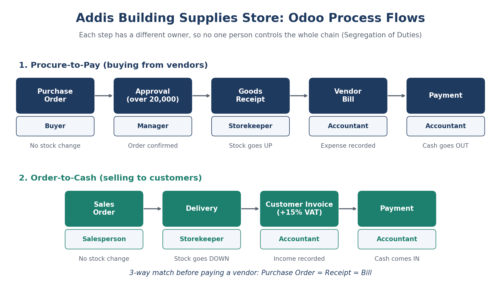

## The business problem

The store tracks stock and orders in Excel files and notebooks. As a result:

- Stock counts are often wrong.
- Anyone can place an order without approval.
- The owner can't see what was bought, sold, or owed without asking each person.

**In short: no control and no visibility.**

## The solution

One shared Odoo system where each employee has their own login and sees only their part of the work. Stock updates automatically at receipt and delivery, large purchases need approval, and bills, invoices, and reports come from the same data.

## What I built

| Area | What I did |
|---|---|
| **Master data** | 10 products with starting stock, 3 vendors, 3 customers. I cleaned a product file (removed duplicates, filled missing prices) and imported it using Odoo's Test before Import. |
| **Users and roles** | 5 users with minimum access: Buyer, Storekeeper, Accountant, Manager, Salesperson. I tested each by logging in as that user. |
| **Approval rule** | Purchase orders above **20,000 ETB** need Manager approval. |
| **Processes** | Procure-to-Pay and Order-to-Cash, run end to end. |
| **Reports** | Stock report, Purchases by Vendor, and Sales by Customer, saved as favorites. |
| **Safety** | Database backup downloaded and stored in two places. |
| **Documentation** | Process diagram, one-page admin guide, and a troubleshooting table. |

## Users and access

| User | Job | Odoo access |
|---|---|---|
| Buyer | Creates purchase orders | Purchase: User |
| Storekeeper | Receives and delivers goods | Inventory: User |
| Accountant | Records bills and payments | Accounting: Bookkeeper |
| Manager | Approves large orders | Purchase: Administrator |
| Salesperson | Creates sales orders | Sales: User (own documents only) |

**Segregation of Duties:** no single person can order, receive, and pay. For example, the buyer cannot validate receipts, and the salesperson can draft an invoice but cannot post it.

## Business cycles I ran

| Cycle | Details | What it proved |
|---|---|---|
| **Purchase 1: cement** | 80 bags at 900 = 72,000. Stopped at **To Approve**, then the Manager approved it. | The approval rule works. |
| **Purchase 2: paint** | 10 buckets at 1,400 = 14,000 (16,100 with 15% VAT). Billed from the PO. | Clean 3-way match: Ordered 10, Received 10, Billed 10. |
| **Sale 1: steel rods** | 40 rods at 350 = 14,000 (16,100 with VAT). Stock went from 100 to 60. | Stock goes down at delivery, not at the order. |
| **Sale 2: nails (backorder)** | 150 ordered, only 100 in stock. Delivered 100, backorder for 50. | Handling not enough stock. |

## Problems I found and fixed

| Problem | Cause | Fix |
|---|---|---|
| Large order did not stop for approval | I was logged in as admin, who can confirm anything | Always check who is logged in, then retest as the Buyer |
| PO showed **Billed = 0** after the bill was paid | The bill was typed by hand, so it was not linked to the PO | Create the bill from the PO (or use Auto-Complete) |
| Delivery warned "processed less than demand" | Not enough stock | Create a backorder, or restock first |
| User could not see the Sales app | No access rights assigned | Settings, Users, Access Rights |
| Vendor bill would not confirm | Missing bill date | Fill in the bill date |
| "Zero quantity transfer" alert on delivery | No stock available to deliver | Check stock on hand and reservation first |
| Imported products had no stock or tracking | Import only fills the columns in the file | Check Track Inventory and add stock after every import |

## Key lessons

- Give each person the **minimum access** they need, then test by logging in as them.
- Approval rules and separate roles stop one person controlling a whole process.
- **Clean data before importing**, and always use Test first.
- Reports are only as good as the transactions behind them.
- The three documents in a purchase (order, receipt, bill) should agree before paying.
- When something breaks: read the message, find the context, check the usual causes, then fix and write it down.

## Screenshots

**1. Large order waiting for approval**

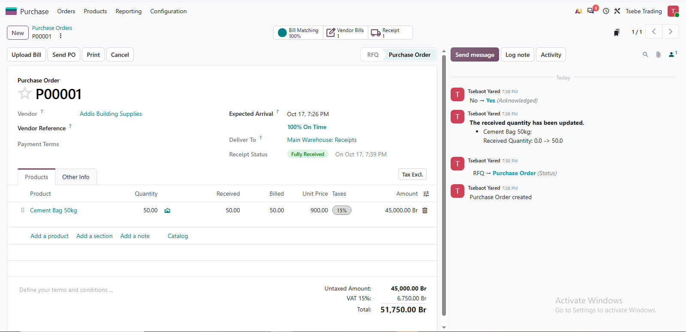

**2. Manager approves the order**

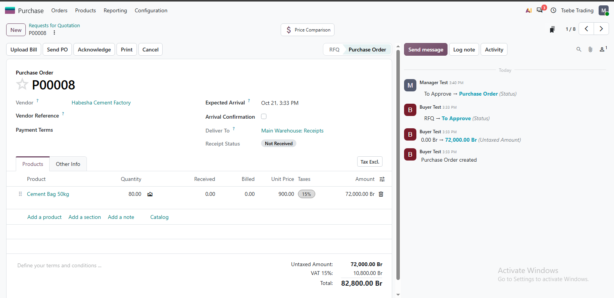

**3. Storekeeper validates the receipt**

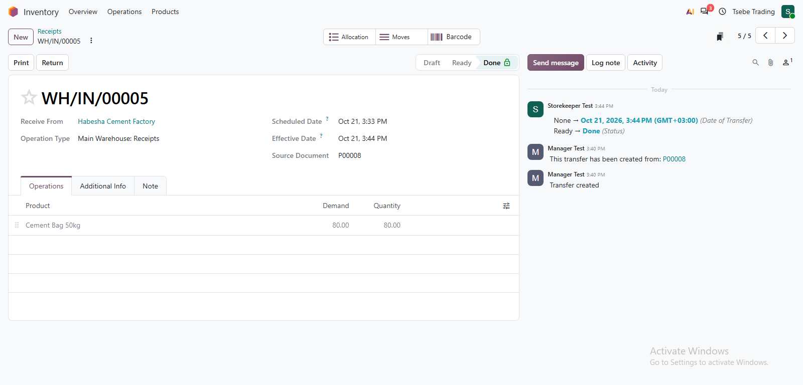

**4. Bill paid**

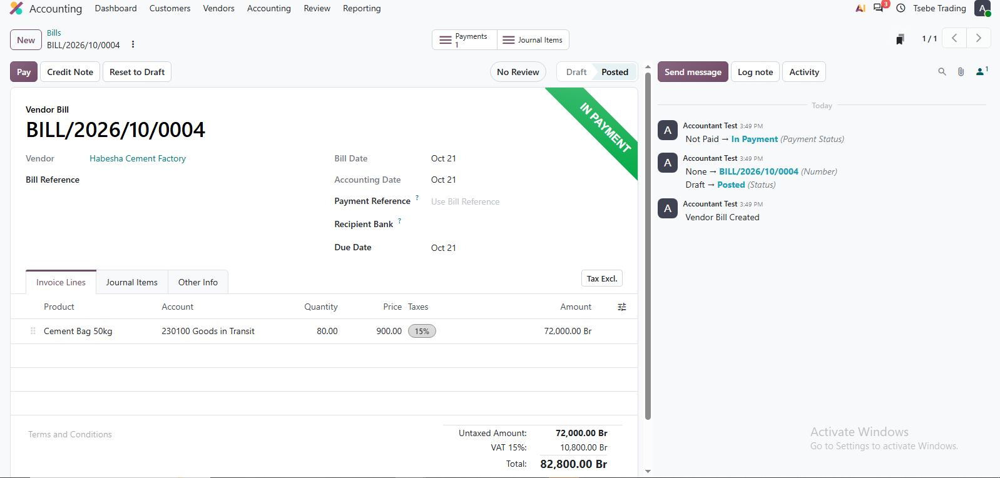

**5. Paint order confirmed**

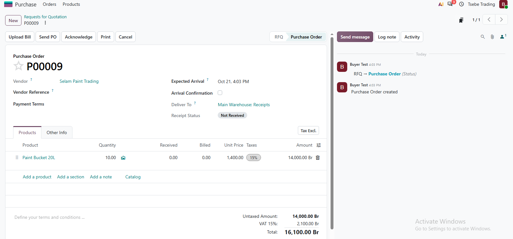

**6. Paint receipt validated**

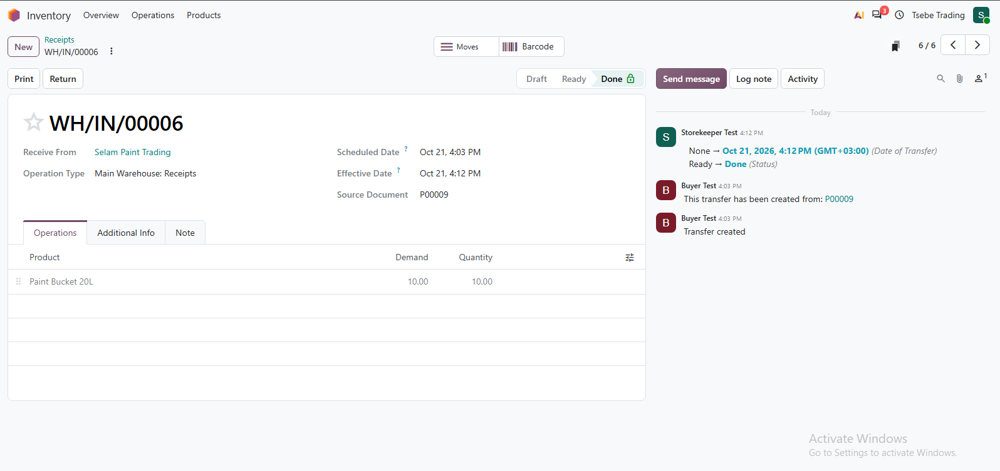

**7. Clean 3-way match (ordered 10, received 10, billed 10)**

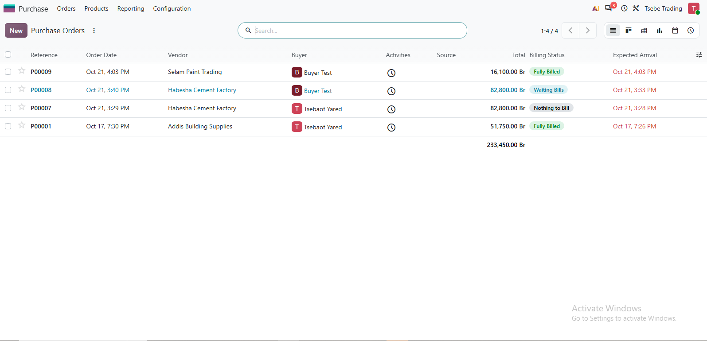

**8. Sale completed**

**9. Backorder created**

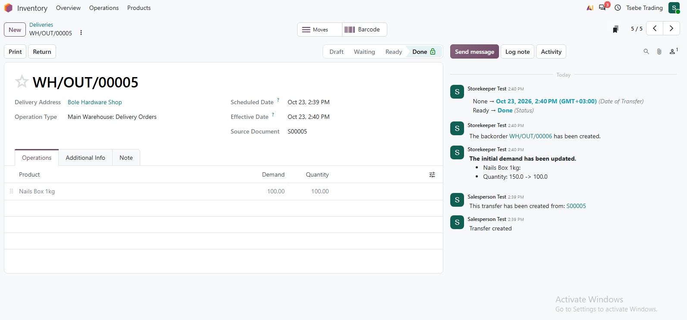

**10. Stock report**

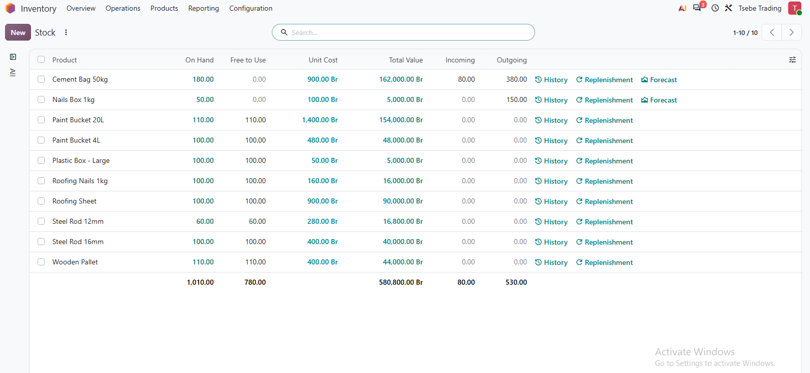

**11. Purchases by vendor report**

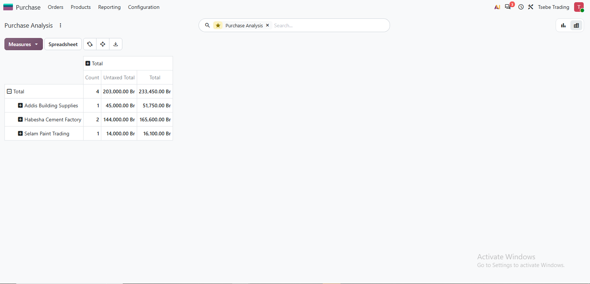

**12. Sales by customer report**

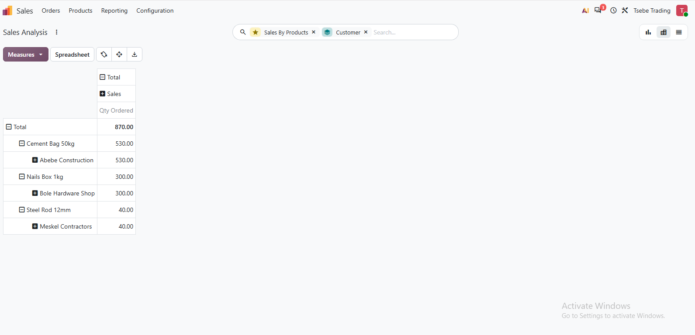

## Tools

Odoo (Inventory, Purchase, Sales, Accounting), Excel for data cleaning and import.

## About me

I'm a Logistics and Supply Chain Management student at Addis Ababa University, building ERP and data skills to support warehouse, procurement, and supply chain work.
